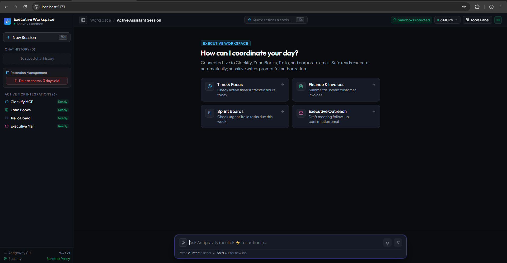
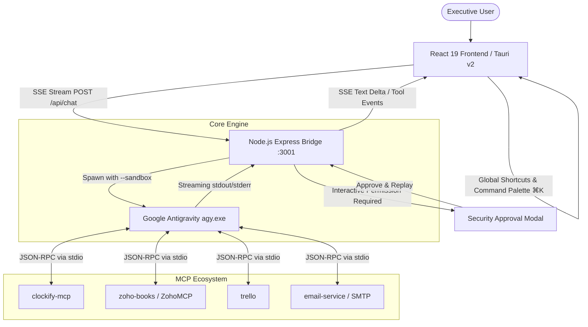

# ⚡ Antigravity Executive Assistant

<div align="center">

[](https://opensource.org/licenses/MIT)
[](https://react.dev/)
[](https://www.typescriptlang.org/)
[](https://vitejs.dev/)
[](https://tauri.app/)
[](https://modelcontextprotocol.io/)

**A production-grade, zero-trust desktop AI executive assistant built over Google Antigravity (`agy`) and the Model Context Protocol (MCP).**

Coordinate business operations, inspect financial ledgers, track time, manage sprints, and draft communications from a single Raycast/Linear-grade interface—designed with the vision of becoming a connector-friendly workspace like Claude where users can plug and play any MCP server.

---



</div>

---

## 🌟 Overview & Vision

Autonomous AI agents and MCP servers have historically been trapped inside terminal CLIs or developer-centric code editors. **Antigravity Executive Assistant** transforms raw agentic capabilities into a polished desktop workspace designed for operators, leads, and everyday users.

> [!NOTE]
> **Vision, Native App Plans & Current Status**:  
> - 🎯 **Connector-Friendly Vision**: The target is to build an intuitive, connector-friendly user interface—similar to Claude—where anyone can simply point and click to connect any MCP server without touching terminal configs.
> - 🖥️ **Native Desktop App**: We are actively exploring packaging this into a fully standalone native desktop app (using Tauri) so users get a seamless one-click installer and native OS integration.
> - 🛠️ **Current State for Technical Users**: Right now, the app requires manual MCP configuration (e.g., Clockify, Zoho Books, Trello) via Antigravity CLI or environment files, making it best suited for developers and technical operators.
> - 🤝 **Open Source & Contributions**: Work is ongoing to make this friendlier for end consumers. Feel free to fork, adapt, and use it in your own workflows—if you'd like to contribute, pull requests, suggestions, and feedback are warmly appreciated!

### Why This Project?
- **Zero-Trust Security**: Safe read queries execute automatically with plan-quota alerts (e.g. Clockify rate limits), while write operations (file mutations, shell commands, sending emails, editing Trello cards) require explicit confirmation via interactive approval modals.
- **Unified Operations**: Directly orchestrates multiple MCP servers simultaneously — auditing **Zoho Books** invoices, checking **Trello** sprints, managing **Clockify** timers, and dispatching **Email** without context-switching.
- **Editorial Desktop Experience**: Built with a deep obsidian matte design system, native 120% desktop typography scaling, collapsible sidebar navigation, and a floating command dock.

---

## ✨ Features

- **⚡ Global Command Palette (`⌘K` / `Ctrl+K`)**:
  - Raycast-style centered search modal with full keyboard navigation (`↑`/`↓`/`↵`/`ESC`).
  - Search and trigger actions across Clockify, Zoho Books, Trello, Email, and workspace window controls.

- **🛡️ Granular Sandbox Security**:
  - Differentiates granular mutations (e.g., distinguishing Trello card comments from card creation).
  - Previews complete operation details, target parameters, and prompt context before authorization.

- **⏱️ Local Chat History & 3-Day Retention Purge**:
  - Stores conversations locally in `localStorage` with initial prompt titles and timestamps.
  - Dedicated **"Delete chats > 3 days old"** feature in both the sidebar and `⌘K` palette for clean history hygiene.

- **📨 Context-Rich Executive Mailer**:
  - Feeds real-time data from Zoho Books (customer balances) and Trello (active sprint cards) directly into generated email drafts.
  - Enforces quota preservation to prevent unnecessary Clockify API consumption.

- **🧠 Transparent Reasoning & Activity Capsules**:
  - Single dynamic activity status capsule with spinning state and completed checkmarks.
  - Collapsible agent reasoning drawer formatted in clean monospace.
  - One-click copy buttons with instant visual feedback.

- **🖥️ Dual Mode (Web & Desktop Native)**:
  - Runs in browser via Vite or compiles directly into a native Windows / macOS desktop application via Tauri v2.

---

## 🏗️ Architecture



---

## 🚀 Getting Started

### Prerequisites

1. **Node.js**: v18.0.0 or higher.
2. **Google Antigravity CLI (`agy`)**: Installed and accessible in your system `PATH`.
   - Verify by running: `agy --version`
3. **Configured MCP Servers**: Ensure your target MCP servers are added to Antigravity:
   ```bash
   agy mcp list
   ```

### Installation

1. **Clone the repository**:
   ```bash
   git clone https://github.com/your-username/antigravity-consumer-app.git
   cd antigravity-consumer-app
   ```

2. **Install dependencies**:
   ```bash
   npm install
   ```

3. **Configure environment variables (optional)**:
   ```bash
   cp .env.example .env
   ```

4. **Start the application**:
   ```bash
   npm start
   ```
   This concurrently boots:
   - Node SSE Bridge server at `http://localhost:3001`
   - Vite React client at `http://localhost:5173`

---

## 🖥️ Running as a Native Desktop App (Tauri)

To compile and launch the native desktop application window:

```bash
npm run desktop
```

To build a standalone production installer (`.exe` / `.msi` / `.dmg`):

```bash
npm run tauri build
```

---

## ⌨️ Keyboard Shortcuts

| Shortcut | Action |
| :--- | :--- |
| **`⌘K` / `Ctrl+K`** | Open Global Command Palette & Action Launcher |
| **`⌘B` / `Ctrl+B`** | Toggle Left Sidebar Navigation |
| **`⌘N` / `Ctrl+N`** | Start a New Clean Executive Session |
| **`↵ Enter`** | Send message in chat input |
| **`Shift + ↵`** | Insert newline in chat input |
| **`ESC`** | Close Command Palette or active modal |

---

## 🔒 Security & Sandbox Policy

By default, the backend bridge spawns Antigravity with the `--sandbox` flag:
- **Zero Global Bypass**: `--dangerously-skip-permissions` is disabled globally.
- **Pre-Authorized Read Operations**: Safe queries (e.g. `list_invoices`, `get_current_timer`, `trelloReadBoard`) proceed automatically.
- **Mandatory Write Authorizations**: Operations modifying external systems trigger an interactive modal displaying the target resource and exact parameters before execution.

---

## 🛠️ Tech Stack

- **Frontend**: [React 19](https://react.dev/), [TypeScript](https://www.typescriptlang.org/), [Vite](https://vitejs.dev/)
- **Desktop Shell**: [Tauri v2](https://tauri.app/) (Rust backend)
- **Styling**: Vanilla CSS Design Tokens (Linear/Raycast Obsidian palette)
- **Icons**: [Lucide React](https://lucide.dev/)
- **Markdown & Code**: [React Markdown](https://github.com/remarkjs/react-markdown), [Remark GFM](https://github.com/remarkjs/remark-gfm)
- **Backend Bridge**: [Express](https://expressjs.com/), Node.js Server-Sent Events (SSE)
- **AI Agent Engine**: [Google Antigravity (`agy`)](https://github.com/google)

---

## 🤝 Contributing & Community

Feel free to copy, fork, adapt, or build upon this project for your own executive or personal AI workflows!

- **Found a bug or have an idea?** Open an issue or start a discussion.
- **Want to contribute?** Pull requests are warmly welcomed — whether it's building zero-config MCP onboarding, adding new provider widgets, or polishing the desktop experience.

---

## 📄 License

This project is open-source and licensed under the [MIT License](LICENSE).
